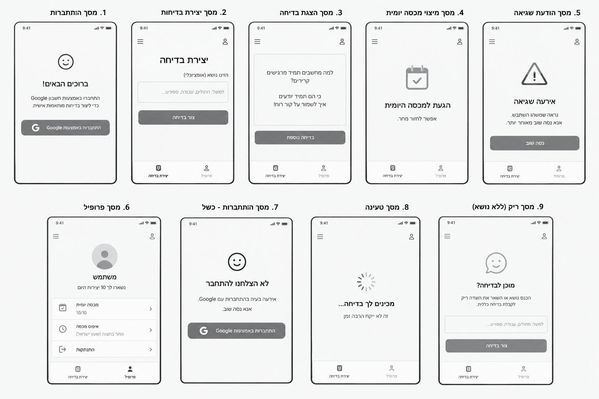
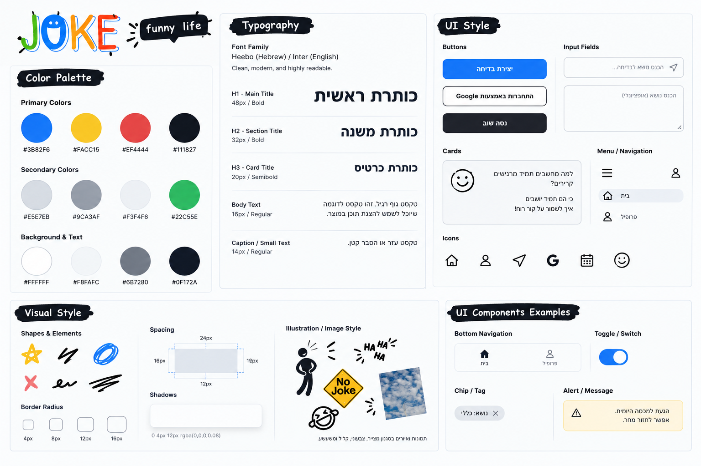
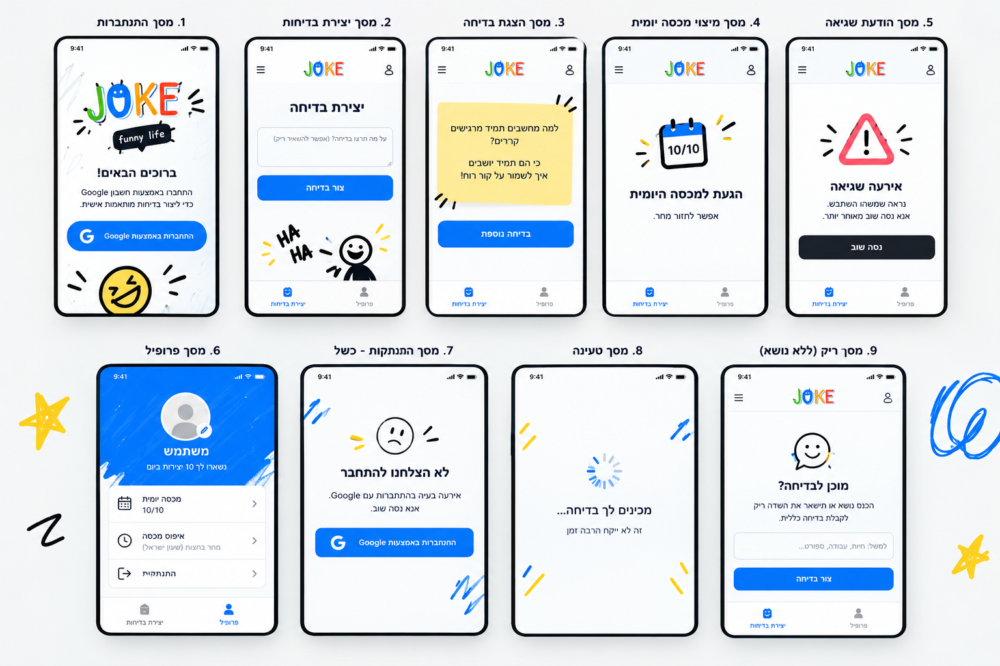

# DESIGN.md — מסמך עיצוב האפליקציה One Joke

## 1. Screens – מסכי האפליקציה

המסכים מתוארים לפי ה-Wireframes וה-Mockups, תוך שמירה על ההתנהגות שהוגדרה ב-PRD. המוצר הוא Web App בעברית המיועד למובייל וניתן להתקנה כ-PWA. **אין התחברות** (PRD 4.א.1): האתר נפתח ישירות במסך היצירה, ולכן חלק מהמסכים שבתמונות אינם נבנים.

**מיפוי מספרי המסכים** — המספור בתמונות שונה מהמספור במסמכים. המסמכים (DESIGN, MILESTONES) משתמשים במספור שמשמאל:

| מסמך | שם | מספר בתמונות | בשימוש? |
|---|---|---|---|
| 1.1 | מסך התחברות | 1 | ❌ לא נבנה |
| 1.2 | מסך יצירת בדיחה (גרסה חלופית) | 2 | ❌ לא נבנה — ראו 1.9 |
| 1.3 | מסך הצגת בדיחה | 3 | ✅ |
| 1.4 | מסך טעינה | 8 | ✅ |
| 1.5 | מסך מכסה יומית שמוצתה | 4 | ✅ |
| 1.6 | מסך שגיאה ביצירת בדיחה | 5 | ✅ |
| 1.7 | מסך שגיאה בהתחברות | 7 | ❌ לא נבנה |
| 1.8 | מסך פרופיל | 6 | ❌ לא נבנה |
| 1.9 | מסך יצירת בדיחה | 9 | ✅ מסך הפתיחה |
| 1.10 | דף פרטיות | — | ✅ |

### מבנה משותף לכל המסכים

- **סרגל עליון:** הלוגו „JOKE” במרכז בלבד. אייקון התפריט ואייקון הפרופיל שבתמונות **אינם נבנים**, כי אין תפריט ואין פרופיל.
- **סרגל ניווט תחתון:** **אינו נבנה**. בלי מסך פרופיל נשאר רק מסך אחד, ואין לאן לנווט.
- **קישור „פרטיות”:** טקסט קטן ואפור בתחתית מסך היצירה (1.9), שמוביל לדף הפרטיות (1.10).

### 1.1 מסך התחברות — לא נבנה

מסך 1 בתמונות אינו נבנה, כי אין התחברות. הלוגו ואיור הפרצוף הצוחק שבו יכולים לשמש במסך היצירה.

### 1.2 מסך יצירת בדיחה (גרסה חלופית) — לא נבנה

מסך 2 בתמונות אינו נבנה. מסך היצירה היחיד הוא 1.9.

### 1.3 מסך הצגת בדיחה

- **מטרה:** להציג את הבדיחה שנוצרה ולאפשר יצירה נוספת.
- **מבנה ותוכן:** סרגל עליון; כרטיס תוכן מרכזי ובו הבדיחה בעברית (עד 4 שורות); כפתור ראשי „בדיחה נוספת”; מתחתיו כפתור משני „נושא אחר” (רקע לבן וקו מתאר כהה, לפי ה-Style Guide); ושורה קטנה „נשארו X מתוך 10 היום”.
- **פעולות וניווט:** „בדיחה נוספת” מבקשת בדיחה חדשה באותו נושא, והיא מחליפה את הקודמת, כך שמוצגת בדיחה אחת בכל רגע. „נושא אחר” מחזיר למסך היצירה (1.9) עם שדה ריק.
- **אחרי הבדיחה העשירית של היום:** הבדיחה מוצגת כרגיל, ובמקום „בדיחה נוספת” מוצגת הודעה בסגנון Alert / Message: „זו הבדיחה האחרונה להיום. אפשר לחזור מחר.”. הכפתור „נושא אחר” לא מוצג.

### 1.4 מסך טעינה

- **מטרה:** להציג שהבקשה ליצירת בדיחה נמצאת בטיפול.
- **מבנה ותוכן:** סרגל עליון, ובמרכז חיווי טעינה מונפש עם הטקסט „מכינים לכם בדיחה...”.
- **פעולות וניווט:** אין פעולה נוספת בזמן ההמתנה. לאחר קבלת התוצאה מוצגת הבדיחה; אם הבקשה נכשלת או שעברו 25 שניות, מוצג מסך השגיאה.

### 1.5 מסך מכסה יומית שמוצתה

- **מטרה:** להסביר מדוע אי אפשר ליצור בדיחה נוספת כרגע.
- **מבנה ותוכן:** אייקון לוח שנה עם סימון, כותרת „הגעתם למכסה היומית” וטקסט „אפשר לחזור מחר.”. המראה ממוקד, ללא כפתור יצירה פעיל.
- **פעולות וניווט:** המשתמש יכול להמתין לאיפוס המכסה ולחזור ביום הבא. המכסה מתאפסת בחצות לפי שעון ישראל.
- **מתי מוצג:** כשהמכסה של המכשיר (10) או התקרה של האתר (300) מוצו. אותו מסך ואותו נוסח לשני המקרים. כשמשתמש פותח את האפליקציה אחרי שהמכסה מוצתה, מוצג המסך הזה במקום מסך היצירה. מיד אחרי הבדיחה העשירית מוצגת עדיין הבדיחה עצמה (ראו 1.3).

### 1.6 מסך שגיאה ביצירת בדיחה

- **מטרה:** להודיע שהיצירה נכשלה ולאפשר ניסיון חוזר.
- **מבנה ותוכן:** אייקון אזהרה גדול, כותרת „אירעה שגיאה”, טקסט קצר כגון „נראה שמשהו השתבש. אנא נסו שוב מאוחר יותר.” וכפתור „נסו שוב”.
- **פעולות וניווט:** לחיצה על „נסו שוב” מפעילה ניסיון חוזר, בכפוף למכסה היומית. יש להשתמש במסך זה גם כאשר לא ניתן להשלים את הבקשה עקב בעיית רשת. אין להציג בדיחת ברירת מחדל במקרה של כשל.

### 1.7 מסך שגיאה בהתחברות — לא נבנה

מסך 7 בתמונות אינו נבנה, כי אין התחברות.

### 1.8 מסך פרופיל — לא נבנה

מסך 6 בתמונות אינו נבנה. מספר הבדיחות שנותרו מוצג במסכי היצירה והבדיחה (1.9, 1.3).

### 1.9 מסך יצירת בדיחה (מסך הפתיחה)

- **מטרה:** לאפשר לכל מי שנכנס להזין נושא, או להשאיר את השדה ריק, ולבקש בדיחה. זהו המסך הראשון שנפתח באתר (אלא אם המכסה מוצתה — ראו 1.5).
- **מבנה ותוכן:** סרגל עליון עם הלוגו; איור פרצוף צוחק; כותרת „מוכנים לבדיחה?”; הסבר קצר: „כתבו נושא, או השאירו את השדה ריק לבדיחה כללית.”; שדה נושא של שורה אחת עם Placeholder „למשל: חתולים, עבודה, ספורט...” ומונה תווים (עד 100); כפתור ראשי „צרו בדיחה”; שורה קטנה „נשארו X מתוך 10 היום”; ובתחתית קישור קטן „פרטיות”.
- **פעולות וניווט:** לחיצה על „צרו בדיחה” מבקשת בדיחה בנושא שהוזן, או בדיחה כללית אם השדה ריק. הקישור „פרטיות” פותח את דף הפרטיות.

### 1.10 דף פרטיות

- **מטרה:** להסביר שלא נאסף מידע אישי (PRD 4.א.8).
- **מבנה ותוכן:** אין לדף הזה Wireframe או Mockup. הוא דף טקסט פשוט: כותרת, כמה פסקאות קצרות בגוף טקסט רגיל, וקישור חזרה. הדף בנוי לפי הטיפוגרפיה, הצבעים והריווח של ה-Style Guide. נוסח הדף טעון אישור.
- **פעולות וניווט:** נפתח מהקישור במסך היצירה; קישור החזרה מוביל למסך היצירה.

### תמונות ייחוס

#### Wireframes

#### Style Guide

#### Mockups

### מבנה הניווט הכללי

כל מי שנכנס לאתר מגיע ישירות למסך יצירת הבדיחה (1.9). משם הוא יכול לבקש בדיחה, לראות מצב טעינה (1.4), לקבל בדיחה (1.3), או לקבל מסך שגיאה (1.6) או מכסה (1.5) לפי תוצאת הפעולה. מהבדיחה חוזרים למסך היצירה בכפתור „נושא אחר”. דף הפרטיות (1.10) נפתח מהקישור בתחתית מסך היצירה. אין התחברות, תפריט, פרופיל או סרגל ניווט תחתון. אין להוסיף מסכי היסטוריה, שיתוף, דירוג או שמירת בדיחות.

## 2. Style Guide – השפה העיצובית

### 2.1 Color Palette

הצבעים הבאים מופיעים ב-Style Guide. יש להשתמש בהם בעקביות, תוך מתן עדיפות למראה הבהיר והמינימליסטי של ה-Mockups.

| תפקיד | צבע | HEX |
|---|---|---|
| Primary Blue | כחול ראשי לפעולות מרכזיות | `#3B82F6` |
| Yellow | צהוב משני / הדגשה | `#FACC15` |
| Red | אדום להדגשה או מצב שגיאה | `#EF4444` |
| Black | שחור לטקסטים ואייקונים | `#111827` |
| Light Gray | אפור בהיר למשטחים וקווי הפרדה | `#E5E7EB` |
| Mid Gray | אפור בינוני לרכיבים משניים | `#9CA3AF` |
| Very Light Gray | רקע בהיר משני | `#F3F4F6` |
| Green | ירוק משני | `#22C55E` |
| White | רקע ראשי | `#FFFFFF` |
| Off-white | רקע בהיר | `#F8FAFC` |
| Gray Text | טקסט משני | `#6B7280` |
| Dark Text | טקסט ראשי | `#0F172A` |

ב-Mockups נראים בעיקר רקע לבן/בהיר, טקסט כהה, קווי מתאר אפורים וכפתורים אפורים במצבים המוצגים. ה-Style Guide מגדיר כחול כצבע הפעולה הראשי; יש להשתמש בו לפעולה ראשית פעילה, אלא אם מצב מסוים במקור מציג מצב אחר.

**קריאוּת:** טקסט לבן על `#3B82F6` אינו עומד ברף הניגודיות המקובל (4.5:1) לטקסט רגיל. לכן **רקע של כפתור ראשי עם טקסט** הוא `#2563EB` (גוון כהה מעט יותר של אותו כחול). `#3B82F6` נשאר לאייקונים, להדגשות ולמצב נבחר. `#9CA3AF` משמש ל-Placeholder ולרכיבים משניים בלבד, לא לטקסט שצריך לקרוא.

### 2.2 Typography

- **גופנים:** Heebo לעברית ו-Inter לאנגלית, בהתאם ל-Style Guide.
- **H1 – Main Title:** ‏48px, Bold.
- **H2 – Section Title:** ‏32px, Bold.
- **H3 – Card Title:** ‏20px, Semibold.
- **Body Text:** ‏16px, Regular.
- **Caption / Small Text:** ‏14px, Regular.
- יש לשמור על היררכיה ברורה בין כותרת המסך, כותרות אזורי תוכן, טקסטי הסבר ותוויות. במסכי מובייל ניתן להתאים את הגדלים כדי לשמור על פריסה נוחה, מבלי לשנות את ההיררכיה.

### 2.3 UI Style

- **כפתורים:** כפתורים בעלי פינות מעוגלות. הכפתור הראשי מלא ובולט; ב-Style Guide מופיעה דוגמה כחולה. כפתור משני יכול להיות בעל רקע לבן וקו מתאר כהה, וכפתור כהה מופיע גם כדוגמת פעולה נוספת. הטקסט ממורכז וברור. יש להציג תוויות פעולה בעברית, למשל „צרו בדיחה”, „בדיחה נוספת” ו„נסו שוב”.
- **שדות קלט:** רקע בהיר, מסגרת דקה בגוון אפור בהיר, פינות מעוגלות וטקסט Placeholder אפור. יש ליישר את תוכן השדה לימין עבור עברית. שדה הנושא אינו חובה.
- **כרטיסים:** משטח בהיר עם מסגרת עדינה, פינות מעוגלות וריווח פנימי נדיב. כרטיס הבדיחה מציג את הטקסט בעברית באופן קריא ומופרד היטב מהרקע.
- **סרגל עליון:** מינימלי, עם הלוגו בלבד (ללא תפריט ופרופיל). אין סרגל תחתון.
- **אייקונים:** אייקונים פשוטים, קוויים ונקיים, בדרך כלל שחורים או אפורים. השימוש כולל חיוך, יצירה/בדיחה, לוח שנה ואזהרה בהתאם למסכים.
- **מצבי מערכת:** הטעינה מוצגת באמצעות Spinner וטקסט קצר; מצב שגיאה משתמש באייקון אזהרה ובכפתור ניסיון חוזר; מצב מכסה משתמש באייקון לוח שנה וטקסט ברור. אין להסתמך על צבע בלבד כדי להסביר את המצב.

### 2.4 Visual Style

- **אווירה כללית:** קלילה, ידידותית, פשוטה ומינימליסטית, עם רמזים חזותיים להומור באמצעות אייקון החיוך והאיורים בסגנון doodle שב-Style Guide. מסכי ה-Mockups עצמם מאופקים ומונוכרומטיים ברובם.
- **צורות ו-Border Radius:** רכיבי ממשק עם פינות מעוגלות. ה-Style Guide מציג מדרג של 4px, ‏8px, ‏12px ו-16px; יש לבחור לפי גודל הרכיב ובהתאם לדוגמאות ה-Mockups.
- **קווי מתאר:** קווים דקים ואפורים לשדות, כרטיסים ומפרידים. מסגרות המכשיר המופיעות בתמונת ה-Mockups הן מסגרת הצגה ואינן רכיב בממשק עצמו.
- **צללים:** צללים רכים ועדינים בלבד. ב-Style Guide מופיעה דוגמת צל `0 4px 12px rgba(0,0,0,0.08)`; יש להשתמש בהם במשורה ולא ליצור עומק חזותי כבד.
- **Spacing:** ה-Style Guide מציג מרווחי ייחוס של 12px, ‏16px, ‏19px ו-24px. יש לשמור על מרווחים עקביים בין שדות, כפתורים, כרטיסים ואזורי תוכן, עם הפרדה ברורה בין קבוצות רכיבים.
- **Layout:** פריסה אנכית, ממוקדת ומותאמת למסך מובייל. במסכי פעולה התוכן העיקרי ממורכז באזור המסך, תוך שמירה על שוליים פנימיים ועל מקום קבוע לסרגל העליון.
- **מסך רחב (מחשב):** אין ממשק ייעודי למחשב (PRD 6). במסך רחב מוצג אותו עיצוב של מובייל, ממורכז, ברוחב מרבי של 480px.
- **תמונות ואיורים:** סגנון האיור המוגדר הוא doodle קליל, עם קווים ידניים, צורות פשוטות וסמלים הומוריסטיים. אין צורך להוסיף תמונות או איורים למסכים מעבר למה שמופיע במקורות.

### 2.5 שפה וכיווניות

- **שפת הממשק:** עברית בכל הכותרות, התוויות, ההודעות, הטקסטים והכפתורים, בהתאם ל-PRD.
- **כיווניות:** ממשק RTL. טקסטים, כותרות, תוויות ושדות בעברית מיושרים לימין. יש להקפיד על סדר ויישור טבעיים לעברית גם ברשימות ובכרטיסים.
- **תוכן LTR:** שמות טכנולוגיות או מותגים כגון PWA יכולים להופיע באותיות המקוריות, תוך שמירה על זרימת טקסט תקינה בתוך ממשק RTL. אייקונים וסמלים מוכרים יכולים לשמור על צורתם המקורית.
- **צורת פנייה:** פונים למשתמש **בלשון רבים** בכל הממשק (למשל „נסו שוב”, „הגעתם”, „כתבו”). הנוסחים בתמונות בלשון יחיד מוחלפים בנוסחים שלמטה.

### 2.6 נוסחי הממשק הסופיים

| מסך | טקסט |
|---|---|
| 1.9 יצירה | כותרת „מוכנים לבדיחה?”; הסבר „כתבו נושא, או השאירו את השדה ריק לבדיחה כללית.”; Placeholder „למשל: חתולים, עבודה, ספורט...”; כפתור „צרו בדיחה”; „נשארו X מתוך 10 היום”; קישור „פרטיות” |
| 1.3 הצגת בדיחה | כפתורים „בדיחה נוספת” ו„נושא אחר”; „נשארו X מתוך 10 היום”; אחרי העשירית: „זו הבדיחה האחרונה להיום. אפשר לחזור מחר.” |
| 1.4 טעינה | „מכינים לכם בדיחה...”; „זה לא ייקח הרבה זמן” |
| 1.5 מכסה | כותרת „הגעתם למכסה היומית”; טקסט „אפשר לחזור מחר.” |
| 1.6 שגיאה | כותרת „אירעה שגיאה”; טקסט „נראה שמשהו השתבש. אנא נסו שוב מאוחר יותר.”; כפתור „נסו שוב” |
| 1.10 פרטיות | כותרת „פרטיות”; קישור חזרה „חזרה ליצירת בדיחה” |

נוסח גוף דף הפרטיות (1.10) ייכתב בשלב הבנייה ויובא לאישור.
